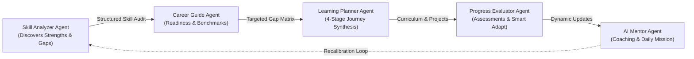

# Skillora AI – Discover Your Potential. Design Your Future.

> *"Every Skill Has a Purpose. Every Learner Has a Future."*

**Skillora AI** is an intelligent, modern, and visually refined AI-powered career learning ecosystem. Unlike traditional platforms that prescribe identical courses to everyone, Skillora AI studies each learner's abilities, identifies hidden skill gaps, crafts personalized learning journeys, and continuously adapts to their performance and career ambitions.

---

## 🌟 Key Highlights & Architecture

- **Personalized Learner Profile:** Seamlessly tracks competencies, project history, and career readiness.
- **Career DNA:** 6-dimensional cognitive & technical engineering diagnostic (Analytical Depth, System Thinking, Creative Iteration, Execution Velocity, Debugging Resilience, Architecture Vision).
- **My Skill Universe:** An interactive celestial constellation map visualizing mastered, in-progress, missing, and recommended skills as interconnected nodes.
- **Intelligent Career Matching & Explorer:** Benchmarks learner skills against 2026 hiring criteria with deep contextual explanations.
- **4-Stage Learning Journey:**
  - **Stage 1: Discover** (Mental models, foundational concepts, web semantics)
  - **Stage 2: Develop** (Core technical execution, JS ES6+, React, Node.js)
  - **Stage 3: Create** (Skill-to-Project Bridge applications)
  - **Stage 4: Achieve** (Production deployment, system design, career readiness simulation)
- **Smart Adapt AI:**
  - `< 50%` on assessment: Automatically injects remedial revision micro-drills.
  - `≥ 85%`: Unlocks accelerated Fast-Track bonus electives and awards the *Diagnostic Vanguard* milestone.
  - Goal Change: Automatically triggers all 5 agents to recalibrate and regenerate the roadmap.
- **AI Mentor & 5-Agent Collaborative Mesh:**
  - **Skill Analyzer Agent:** Audits strengths & isolates critical gaps.
  - **Career Guide Agent:** Calculates Career Readiness Score and benchmarks job roles.
  - **Learning Planner Agent:** Synthesizes the 4-stage journey.
  - **Progress Evaluator Agent:** Grader and Smart Adapt AI decision engine.
  - **AI Mentor Agent:** Personal coach, daily goals, and multi-agent coordinator.
- **Skill-to-Project Bridge:** Hands-on mini projects with an in-browser code editor, automated test runner, and **Live Interactive Artifact Previews**:
  1. *JavaScript Interactive Calculator*
  2. *React Developer Portfolio*
  3. *Node.js & Express REST API*
  4. *Relational Database Schema & Window Query Analytics*
- **Future Me:** Inspiring side-by-side transformation preview comparing **My Current Self** with **My Future Self**.
- **Progress & Milestones:** Streak tracking, weekly learning pace bar chart, and milestone badges.

---

## 🚀 Quick Start Guide

### Prerequisites
- Python 3.9+
- Modern Web Browser (Chrome, Safari, Firefox, Edge)

### Installation & Launch

1. **Clone the repository:**
   ```bash
   git clone https://github.com/deekshanyarm-source/Skillora-AI.git
   cd Skillora-AI
   ```

2. **Run the Automated Test Suite:**
   ```bash
   python3 test_suite.py
   ```
   *(All 10 unit and integration tests run in under 0.02s)*

3. **Start the Application Server:**
   ```bash
   python3 server.py 8081
   ```

4. **Access in your browser:**
   Open [http://localhost:8081](http://localhost:8081)

---

## 🏛️ Multi-Agent Architecture



### Career Readiness Scoring Formula
$$\text{Readiness Score} = 0.20 \times \text{Aptitude} + 0.40 \times \text{SkillMatch} + 0.20 \times \text{RoadmapProgress} + 0.15 \times \text{ProjectBridge} + 0.08 \times \text{Assessments}$$

---

## 📂 Project Structure

```
Skillora-AI/
├── database.py       # SQLite database schema, domain models & Deeksha seed data
├── agents.py         # 5 Specialized Agents, Smart Adapt AI logic & quiz bank
├── server.py         # Full-stack Python HTTP server & REST API endpoints
├── test_suite.py     # 10 unit and integration tests verifying all features
├── static/
│   ├── index.html    # Single-page application markup with 8 main views
│   ├── styles.css    # Soft lavender, subtle blue & deep indigo design system
│   └── app.js        # Controller, Canvas visualizations & interactive sandbox
└── README.md         # Project documentation
```

---

## 📜 License
MIT License. Built with passion for learners everywhere.
